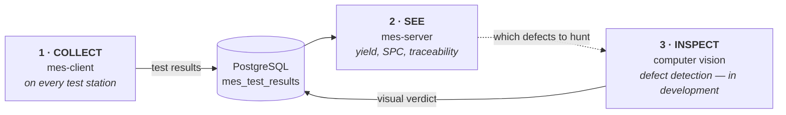

# Roberto Parente

### Test Engineer @ Salcomp · I build the systems that make a factory measurable

I test lithium batteries and chargers for global consumer-electronics brands — and
I write the production software that captures, validates and traces every result.
**21 years** on the factory floor: LG, Sagem, Jabil, Flex, and Salcomp since 2018.
Manaus, Brazil.

Most people in manufacturing software come from one side or the other. I work on
both: I can argue LSL/USL limits with the process engineer, then ship the Windows
service that streams those results into PostgreSQL and survives the network
dropping at 3 a.m.

---

## What that's worth, in numbers

| Problem | What I did | Result |
|---|---|---|
| Station capped at 1,500 UPH; vendor said buy a second one | Found the bottleneck was the test plan, not the hardware — proved it by benchmarking two CPUs, then cut timeouts to spec and dropped a step with no measurement | Test time **35s → 18s (−48%)**, cycle **45s → 31s (−31%)**, **~+31% UPH**, **zero CAPEX** |
| New product; vendor said the existing stations wouldn't work — buy two more, millions of dollars | Led the retrofit of **3 idle stations** from an earlier program instead: commissioning, mechanical and electrical rework, programming, debug, working directly with R&D in China | Two machine purchases avoided, **millions of dollars** saved, NPI schedule met in full |
| Supplier cells arriving near the lower spec limit; yield fell below 80%. Proposal: recharge ~80,000 cells at ~25 min each | Traced the rejects to a single wake-up step while the cells still met every functional requirement, and disabled that step alone — every other quality gate untouched | Yield back to target, **80,000+ cells not recharged**, **no line stoppage**, software-only |
| Test stations sending two logs at once; the MES integration API discarded one | Read the test software, found the collision, and rewrote the send as a sequenced handshake — first log, wait for the transaction to confirm, then the second | **Log losses eliminated**, rework and traceability gaps closed, no hardware change |

Two more, smaller but the same shape: a Visual Basic tool that recovered a broken
MES route and **prevented ~3,500 batteries from being scrapped**, and another that
**saved ~3,000 PCMs** after a serial-number programming station failed to write
memory. Plus a C# poka-yoke enforcing FIFO and shelf life on battery cells, so an
expired cell can't reach finished goods.

The pattern, if you're scanning: **I get told to buy equipment, and I find the
answer in software instead.**

---

## One system, three layers

These aren't three side projects. They're one thing being built in stages — a
data spine for the production line. Each layer feeds the next.

### 1 · Collect — [mes-client](https://github.com/robertoeng-dev/mes-client)

Runs 24/7 on each test station. Watches the CSV files that PCM Tester and
CYG/NAVAJO equipment produce, reads only the new bytes, validates every row and
writes to a central PostgreSQL — without ever losing a test result.

- **Incremental byte-offset parsing** — files grow all shift; re-reading them
  every 5 seconds would stall the station
- **Schema-flexible ingestion via JSONB** — every product model has different CSV
  columns; the database accepts any of them with no `ALTER TABLE`
- **Offline queue with claim/ack semantics** — the network drops, the queue holds,
  and nothing is deleted until the database confirms the write
- **Spec-limit auditing** — compares the limits the tester actually used against
  engineering's official spec, and logs every divergence
- **Real deployment path** — PyInstaller build, Inno Setup wizard, Task Scheduler
  auto-start, per-station config, secrets in `.env`

`Python 3.13` · `PostgreSQL` · `Tkinter` · `psycopg2` · `PyInstaller` · `Inno Setup`

### 2 · See — [mes-server](https://github.com/robertoeng-dev/mes-server)

The other half. Turns what the client collects into decisions: First Pass Yield,
UPH, failure traceability and statistical process control.

- **Two personas, two designs** — operators need a glance-and-go line view;
  engineering needs historical filtering and distribution analysis
- **SPC with Cp/Cpk capability metrics** — the language quality engineers speak
- **Read-only against production data** — writes only to its own carrier table,
  so the dashboard can never corrupt the results it reports on

`Django 6` · `PostgreSQL` · `pandas` · `numpy` · `scipy` · `Chart.js`

### 3 · Inspect — machine vision on the line *(in development)*

Automated cosmetic defect inspection: catching the bad part at the source instead
of finding it downstream in electrical test. This is the layer that closes the
loop — layer 2 tells you *which* defects are costing yield, and layer 3 goes
looking for them in the image.

The hard part isn't the vision. It's the integration. I'm building **VisionLink**,
a Python service that sits between the machine-vision inspection program and the
line PLC:

- **Four-phase interlocked handshake** — `PART_IN_POSITION` → `LINK_BUSY` →
  result written → `DONE`. Without the interlock bits you get a race condition
  where the PLC reads the *previous* part's verdict. It only shows up at
  production cadence, and it's the number-one defect in this class of integration
- **State machine that never hangs** — every state has a timeout, every error
  path signals the PLC on a dedicated fault bit and returns to `IDLE`
- **Four replaceable modules** — vision client, PLC client, state machine,
  persistence. The vision client doesn't know the PLC exists; the PLC client
  resolves logical names (`part_in_position`, `result_ok`) through a YAML memory
  map, so re-pointing it at different hardware is a config change
- **Vendor protocol reverse-engineered, then verified live** — I reconstructed the
  trigger and response format from the integrator's driver source, then confirmed
  it against the running vision software: the trigger went out, and the vision
  program's own debug tree showed it parsing the serial correctly
- **Honest about what isn't proven** — the full OK/NG round trip needs the real
  camera on the line, so that test closes at the factory, not on my bench

Non-blocking async persistence writes serial, verdict, measurements and image
path — if it falls over, the inspection cycle keeps running.

`Python 3.13` · `FINS/TCP` · `PLC` · industrial machine vision · `pytest` · `PyInstaller`

> Alongside it, I maintain the C#/.NET inspection application that ties an
> existing connector-inspection station to MES — the same problem one generation
> back, in a different language.

---

## Also on the floor

**UPH Analyzer — time study from a phone video** *(internal tool, private repo)*.
Manual cycle-time studies take a stopwatch, a clipboard and a day of someone's
time. Here, automation films the machine for 1–3 minutes, and an offline Windows
app does the rest:

- **Motion per region of interest** (OpenCV) — every robot, rotary table and
  linear guide gets its own ROI; the app detects when each one moves or waits,
  splits every cycle into Westinghouse elements and classifies them AV / NNVA / NVA
- **The bottleneck, not just the average** — cycle time, UPH against a
  configurable target and takt, and the one stage that limits the line, with the
  improvement opportunities ranked by UPH gained
- **The engineer stays in charge** — a frame-by-frame editor with live markers
  (green = moving, red = stopped, with a timer per position) and a full-screen
  review that loops one cycle so a human can correct what the automation saw
- **Report in minutes** — annotated video, Excel, and an HTML/PPTX report in the
  company template; optional AI review (local Claude Code) writes the narrative,
  the measurements always come from the video
- **Before × after** — film again after the fix, and the new version shows the
  UPH gain against the previous one
- Operator hands via MediaPipe; ArUco markers for parts the camera can't separate

`Python` · `OpenCV` · `MediaPipe` · `PySide6` · `pandas` · `python-pptx` · `FFmpeg` · `PyInstaller` · `Inno Setup`

**AOI photo retrieval by serial number** — a technician pastes a list of serials
and gets back every capture image for those units, for failure analysis. Written
in PowerShell, documented so anyone on the floor can run it without help. Small
tool, but it's the kind that actually gets used: no install, double-click, plain
Portuguese instructions, and it tells you which serials it couldn't find.

---

## Toolbox

| | |
|---|---|
| **Languages** | Python · C# · Visual Basic · SQL · PowerShell |
| **Data** | PostgreSQL · pandas · numpy · scipy |
| **Web / backend** | Django · Chart.js |
| **Desktop & delivery** | PySide6 · Tkinter · PyInstaller · Inno Setup · Windows Task Scheduler |
| **Vision** | OpenCV · MediaPipe · ArUco |
| **Manufacturing** | Test automation · SPC (Cp/Cpk) · traceability · MES · VSM · calibration |

---

## Background

- **Postgraduate — Software Engineering (Quality & Testing)** · 2025
- **Postgraduate — Automated Testing for Intelligent Systems** · UEA, 2024
- **B.Tech, Systems Analysis and Development** · 2024
- **Electronics Technician** · IFAM, 2002
- **Six Sigma Green Belt** (LG) · SMT for Industry 4.0 (ITEGAM)
- Path: Visual Basic → C# → Python — always pointed at the production line

**Where I've done it:** Salcomp (2018–), Flex/MASA — game consoles and set-top
boxes, Jabil — digital cameras, Sagem — GSM handsets with JTAG boundary-scan,
LG — DVD/TV test jigs. Five new production lines commissioned, three of them in
partnership with teams in China and France.

---

## Contact

- **Email** — [robertotec.eng5@gmail.com](mailto:robertotec.eng5@gmail.com)
- **LinkedIn** — [roberto-parente-732b2a411](https://www.linkedin.com/in/roberto-parente-732b2a411/)
- **Location** — Manaus, Amazonas, Brazil · open to remote
- **Languages** — Portuguese (native) · English (advanced technical reading, intermediate conversation)

---

<b>🇧🇷 Português</b>

 

Trabalho com engenharia de teste na Salcomp, em Manaus. Testo baterias de lítio e
carregadores para marcas globais de eletrônicos de consumo — e escrevo os sistemas
de produção que capturam, validam e rastreiam esses dados. São 21 anos de chão de
fábrica: LG, Sagem, Jabil, Flex e Salcomp.

Quase todo mundo em software para manufatura vem de um lado só. Eu trabalho nos
dois: discuto limites LSL/USL com o engenheiro de processo e depois entrego o
serviço Windows que joga esses resultados no PostgreSQL e sobrevive à rede caindo
às 3 da manhã.

**Não são três projetos separados — são três camadas do mesmo sistema:**

**1 · Coletar** — [mes-client](https://github.com/robertoeng-dev/mes-client):
agente que roda 24/7 em cada estação de teste. Leitura incremental por offset,
schema flexível em JSONB, fila offline que não perde dado e auditoria de limites
de especificação.

**2 · Enxergar** — [mes-server](https://github.com/robertoeng-dev/mes-server):
dashboard de First Pass Yield, UPH, rastreabilidade de falhas e CEP com Cp/Cpk.

**3 · Inspecionar** — visão de máquina na linha *(em desenvolvimento)*: inspeção
automática de defeito cosmético, pegando a peça ruim na origem em vez de no teste
elétrico lá na frente. A parte difícil não é a visão — é a integração. Estou
construindo o **VisionLink**, serviço em Python entre o programa de visão e o CLP
da máquina: handshake intertravado de quatro tempos (que é o que evita o CLP ler
o veredito da peça anterior), máquina de estados com timeout em todo estado, e
quatro módulos substituíveis de forma independente.

A camada 2 diz **quais** defeitos estão custando yield; a camada 3 vai procurá-los
na imagem. É isso que fecha o ciclo.

**Também no chão de fábrica — UPH Analyzer** *(ferramenta interna)*: cronoanálise
a partir de um vídeo de 1–3 min da máquina. Mede o movimento de cada robô, mesa e
guia linear, separa os elementos Westinghouse (AV/NNVA/NVA), aponta o GARGALO
contra a meta de UPH e gera vídeo anotado, Excel e relatório HTML/PPTX. O
engenheiro revisa tudo num editor com marcadores ao vivo e numa revisão em tela
cheia do ciclo em loop.

Formado em Análise e Desenvolvimento de Sistemas, com pós em Testes Automatizados
para Sistemas Inteligentes e em Engenharia de Software (Qualidade e Testes).

